

  <a href="https://tohinisland.vercel.app/">
    
  </a>

  


Hi, I'm **Tohin Majumder**, an AI backend engineer in Gurugram, India. I build AI agents, the backends they run on, and the checks that prove they did the work.

Right now I design and ship the agentic AI microservice behind [O3 Origin](https://www.o3origin.com), and the backend it runs on. I'm open to roles in AI engineering, AI backend engineering, distributed systems and applied AI, in India or remote.

- **IEEE ISAECT 2025:** WalkGuardian, path-boundary detection with YOLOv8 (AP@0.5 95.6%, 50 FPS)
- **Hackathon winner:** AI Coach, a schema-validated LLM feedback pipeline
- **B.Tech**, Computer Science and Engineering (AI and ML), Sharda University, 2022 to 2026


  
  <a href="https://www.linkedin.com/in/tohin-majumder-7a6139270/"></a>
  <a href="mailto:tohin1400@gmail.com"></a>
  <a href="https://leetcode.com/u/tohin003/"></a>
  
  <a href="https://tohinisland.vercel.app/Tohin-Majumder-Resume.pdf"></a>

  My portfolio is a playable low-poly island: <a href="https://tohinisland.vercel.app/"><b>tohinisland.vercel.app</b></a>


  <a href="https://github.com/tohin003/Pebble"></a>
  <a href="https://github.com/tohin003/Truthstone"></a>
  <a href="https://github.com/tohin003/AgentGuard"></a>
  <a href="https://github.com/tohin003/BoomBoom">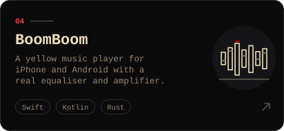</a>
  <a href="https://github.com/tohin003/agent-hub">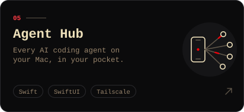</a>
  <a href="https://github.com/tohin003/ginie-releases"></a>

**01 · [Pebble](https://github.com/tohin003/Pebble)**: an open-source AI agent that lives on your Mac. 
A desktop companion that chats, works in your projects and asks before it edits, with the model you choose. On a held-out set it did 235 of 255 tasks correctly (92.2%), against 213 (83.5%) for Claude Code on the same model. 
`Python` `Rust (Tauri 2)` `Vue 3` `TypeScript` `llama.cpp` · [Website](https://pebble-landing-page-eta.vercel.app) · [Latest release](https://github.com/tohin003/Pebble/releases/latest)

**02 · [Truthstone](https://github.com/tohin003/Truthstone)**: plugins that check a coding agent's claim of "done". 
AgentGuard, renamed and packaged for Claude Code and Codex: hooks that check an agent's claims against the repository, plus six practice skills. On a sealed Codex benchmark, false completions fell from 25 of 138 to 2 of 138. Deterministic and local, with no LLM of its own. 
`Python` `Claude Code plugin` `Codex plugin` `Agent skills` · [PyPI](https://pypi.org/project/truthstone/) · [Latest release](https://github.com/tohin003/Truthstone/releases/latest)

**03 · [AgentGuard](https://github.com/tohin003/AgentGuard)**: the original reliability layer for AI coding agents. 
Where Truthstone started: the source-install build for Claude Code. It checks an agent's claims against the repository, watches scope and refuses a "done" that no test backed. In its mutation benchmark it flagged 392 of 400 seeded fake references, with no false positives. 
`Python` `FastAPI` `AST` `SQLite` `QLoRA` · [Fine-tuned model](https://huggingface.co/tohin03/qwen35-4b-personal-coder)

**04 · [BoomBoom](https://github.com/tohin003/BoomBoom)**: a yellow music player for iPhone with a real equaliser. 
A native iPhone player with a ten-band equaliser, an amplifier and Spatial mode, playing YouTube Music through a hidden browser tab. A personal project, not affiliated with YouTube or Google, installed from Xcode with a free Apple ID. 
`Swift` `SwiftUI` `C` `WKWebView`

**05 · [Agent Hub](https://github.com/tohin003/agent-hub)**: every AI coding agent on your Mac, in your pocket. 
Run Claude Code, Codex, OpenCode, Gemini CLI and Antigravity on your Mac, then watch, answer and steer them from your iPhone over Tailscale, with a live view of the Mac's screen as hardware video. 
`Swift 6` `SwiftUI` `Liquid Glass` `Tailscale` `tmux` · [Latest release](https://github.com/tohin003/agent-hub/releases/latest)

**06 · [Ginie](https://github.com/tohin003/ginie-releases)**: a compact, private AI workspace for macOS and Windows. 
Google, ChatGPT, Gemini and Claude in one compact window that asks the OS to keep it out of screen capture. Capture the display under your cursor, attach it to your AI chat and review it before sending. Preview release, installers only. 
`Electron` `TypeScript` `Next.js` · [Website](https://ginie-web-eight.vercel.app) · [Downloads](https://github.com/tohin003/ginie-releases/releases/latest)


  <picture>
    <source media="(prefers-color-scheme: dark)" srcset="https://raw.githubusercontent.com/tohin003/tohin003/output/snake-dark.svg">
    <source media="(prefers-color-scheme: light)" srcset="https://raw.githubusercontent.com/tohin003/tohin003/output/snake-light.svg">
    
  </picture>

  <a href="https://tohinisland.vercel.app/">
    
  </a>

  The portrait at the top is my avatar, redrawn in printable ASCII (0x20 to 0x7E). The graphics on this page are plain SVG with no JavaScript, generated by the scripts in <a href="https://github.com/tohin003/tohin003/tree/main/scripts">scripts/</a>.

